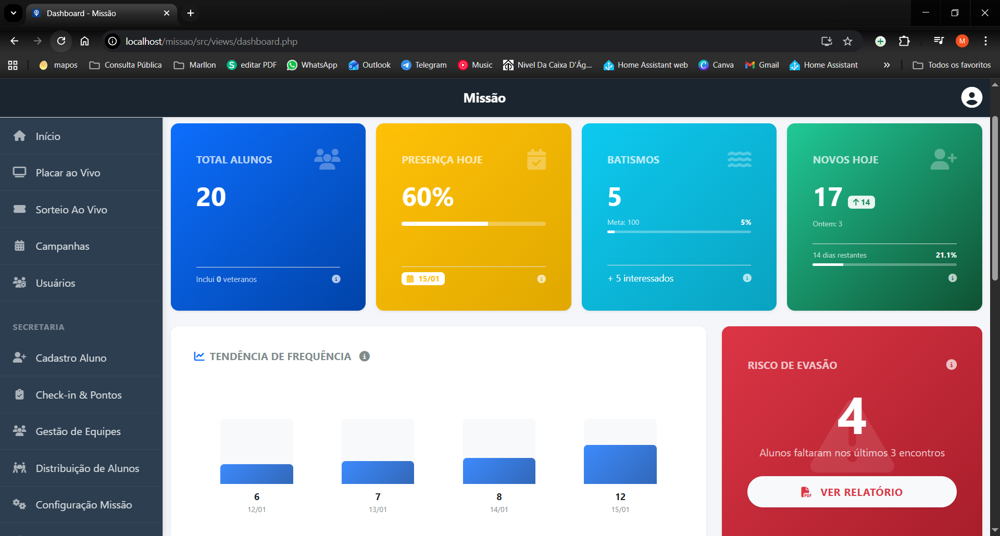
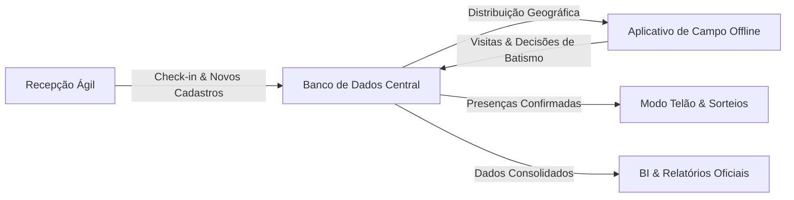
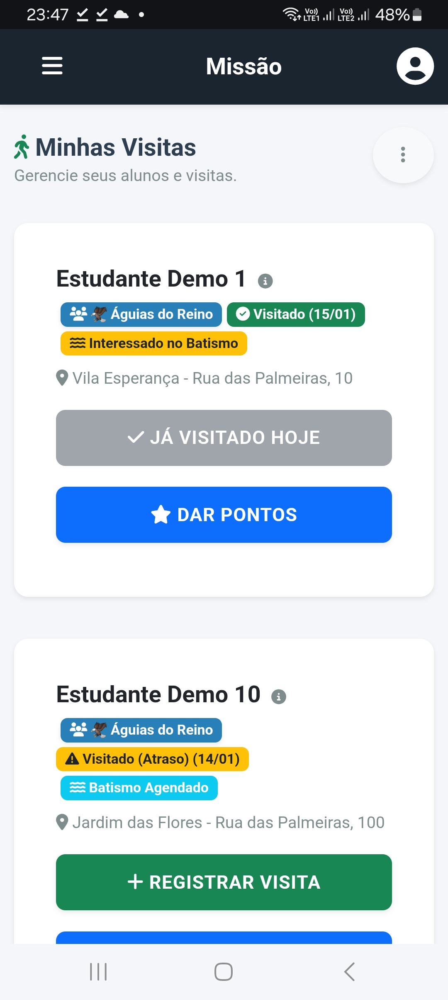
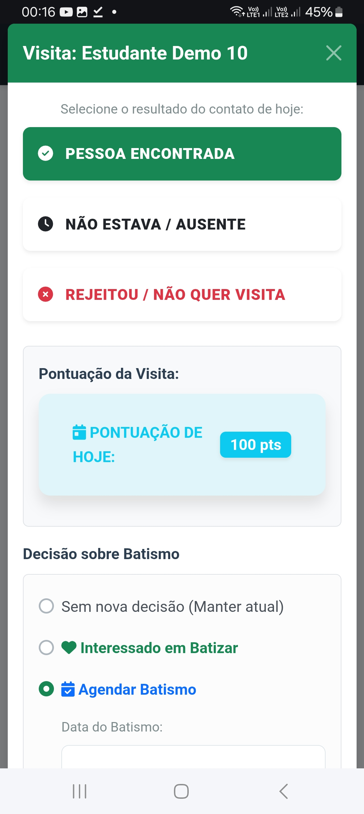
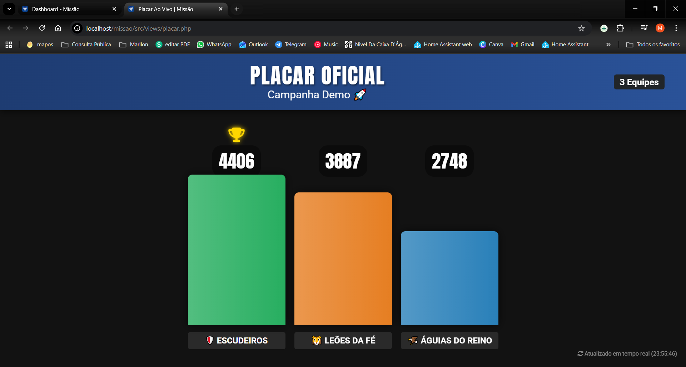
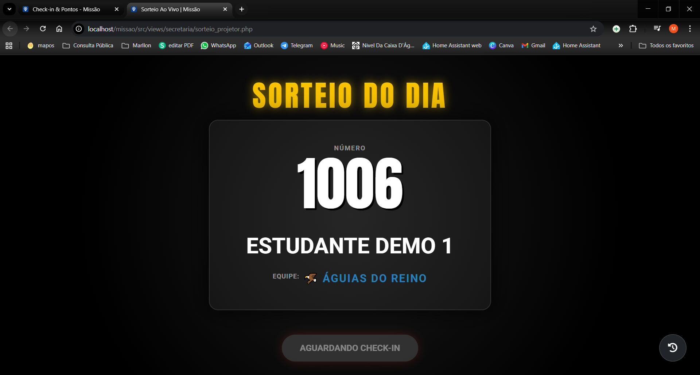
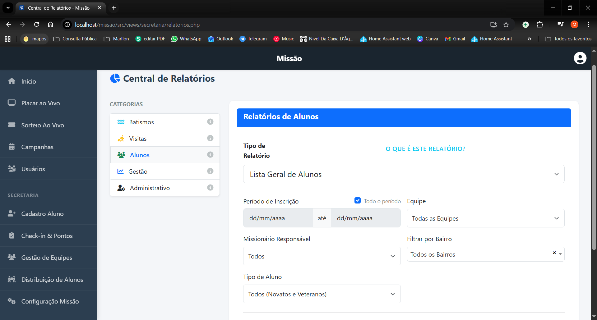

# 🚀 Missão - Plataforma Completa de Gestão Ministerial e Campanhas Evangelísticas

O **Missão** é uma plataforma robusta, moderna e de alta performance desenvolvida especificamente para transformar a gestão de campanhas evangelísticas, semanas de oração, projetos missionários de férias (como Missão Calebe), cruzadas públicas e ações comunitárias.

> [!TIP]
> 🌐 **Portal Oficial & Planos:** Para conferir a tabela de valores dos planos, simular campanhas simultâneas ou testar a demonstração interativa, acesse o site oficial: **[appmissao.com.br](https://appmissao.com.br/)**.

Projetado para atender desde congregações locais até grandes coordenações e evangelistas itinerantes independentes, o sistema integra em um único ecossistema seguro:
1. **A Agilidade da Recepção:** Check-in inteligente em segundos e blindagem antiduplicidade.
2. **A Linha de Frente no Campo:** Aplicativo mobile 100% offline para os voluntários e metodologia bíblica de duplas missionárias.
3. **A Força Visual do Auditório:** Modo telão com sorteador justo ao vivo e placares animados de gincana.
4. **A Tomada de Decisão da Liderança:** Dashboards com alertas de batismo, radar de evasão e mais de 24 relatórios analíticos em PDF.

---

  

---

## 📌 Sumário Executivo
- [🌟 Visão Geral e Pilares do Ecossistema](#-visão-geral-e-pilares-do-ecossistema)
- [⚙️ Arquitetura Modular e Gestão de Campanhas](#️-arquitetura-modular-e-gestão-de-campanhas)
- [📱 A Força de Campo: Aplicativo Mobile & Duplas Missionárias](#-a-força-de-campo-aplicativo-mobile--duplas-missionárias)
- [⚡ O Coração Operacional: Secretaria Ágil & Antierro](#-o-coração-operacional-secretaria-ágil--antierro)
- [🎨 Gráfica Própria Integrada: Certificados e Cartões](#-gráfica-própria-integrada-certificados-e-cartões)
- [📺 Auditório, Gamificação e Modo Telão](#-auditório-gamificação-e-modo-telão)
- [📊 Central de Relatórios e Inteligência Espiritual (+24 Modelos)](#-central-de-relatórios-e-inteligência-espiritual-24-modelos-oficiais)
- [📈 Painéis de Controle e BI em Tempo Real (Dashboards)](#-painéis-de-controle-e-bi-em-tempo-real-dashboards)
- [🛡️ Hierarquia de Acessos, Permissões e Segurança](#️-hierarquia-de-acessos-permissões-e-segurança)
- [🌐 Tecnologia PWA & Infraestrutura em Nuvem](#-tecnologia-pwa--infraestrutura-em-nuvem)
- [🌐 Site Oficial, Planos e Demonstração](#-site-oficial-planos-e-demonstração)
- [📄 Propriedade Intelectual e Licença](#-propriedade-intelectual-e-licença)

---

## 🌟 Visão Geral e Pilares do Ecossistema

O sistema foi estruturado sobre quatro pilares fundamentais para garantir que nenhum interessado seja esquecido e que a equipe trabalhe com máxima sinergia:

* **Cadastro 100% Liberado:** Sem limite de alunos, visitantes, interessados ou voluntários cadastrados. Atenda com tranquilidade desde uma pequena igreja local até grandes cruzadas evangelísticas com milhares de inscritos.
* **Universal e Flexível:** Adaptável para congregações locais, associações regionais, projetos temporários ou evangelistas itinerantes que realizam missões em múltiplas cidades.
* **Foco no Resultado Espiritual:** Muito além de registrar presenças, o sistema prioriza o acompanhamento do estudo da Bíblia, a decisão espiritual e a condução ao batismo.

---

## ⚙️ Arquitetura Modular e Gestão de Campanhas

Cada projeto no sistema é tratado como uma **Campanha Independente**, com configurações próprias de datas, metas, equipes e participantes:

### 1. Módulos Flexíveis sob Medida
A liderança escolhe exatamente o perfil de cada evento com apenas um clique:
* **Modo Evangelístico Direto / Solene:** Para semanas de oração, colheitas, ciclos de conferências ou séries doutrinárias. O sistema opera com telas limpas e enxutas, mantendo o foco exclusivo em recepção, visitas, lições bíblicas e decisões de batismo.
* **Modo Dinâmico com Gamificação:** Para Missão Calebe, semanas de evangelismo jovem ou grandes ações comunitárias. Ativa com um toque:
  * **Gincana de Equipes:** Pontuações diárias por presença, tarefas cumpridas e visitas realizadas.
  * **Placar ao Vivo:** Telão gigante animado para exibição das pontuações no auditório.
  * **Leilão de Talentos:** Feira de encerramento onde participantes usam os pontos acumulados para adquirir Bíblias, livros e brindes.
  * **Sorteador Digital:** Dinâmica interativa com animações visuais para o auditório.

### 2. Multi-Campanhas Simultâneas e Preservação de Histórico
* **Projetos Simultâneos:** Gerencie múltiplos eventos em andamento ao mesmo tempo no mesmo painel (ex: uma missão jovem no bairro A e uma semana especial na congregação B).
* **Encerramento Protetivo:** Ao marcar uma campanha como finalizada, o sistema bloqueia novas edições operacionais por secretárias e voluntários para blindar os dados oficiais contra alterações acidentais.
* **Liberação de Vagas sem Perda de Dados:** A vaga no plano é imediatamente liberada para a próxima campanha, enquanto todo o histórico da anterior (alunos, decisões, visitas e pontuações) permanece arquivado com segurança para consultas e relatórios.

---

## 📱 A Força de Campo: Aplicativo Mobile & Duplas Missionárias

Projetado especificamente para a rotina do missionário na rua e o evangelismo "porta a porta":

  
  &nbsp;&nbsp;&nbsp;&nbsp;
  

### Recursos Essenciais do Aplicativo:
* **Instalação em 1 Clique (PWA):** Instale diretamente pelo navegador adicionando o ícone à tela inicial do celular (Android e iOS). Leve, consome pouquíssima bateria e não depende de download em lojas de aplicativos.
* **Operação 100% Offline:** O voluntário carrega sua carteira de contatos antes de sair e atua em áreas rurais ou bairros sem sinal de celular. Pode consultar endereços, ler anotações anteriores e registrar novos atendimentos sem precisar de internet.
* **Sincronização Automática Resiliente:** Ao reconectar ao Wi-Fi ou dados móveis, o aplicativo detecta o sinal e envia todas as visitas e decisões instantaneamente para o servidor central.
* **Módulo Oficial de Duplas Missionárias:**
  * Fundamentado na prática bíblica de enviar os discípulos de dois em dois (Marcos 6:7).
  * Dois voluntários formam uma dupla no sistema e suas carteiras de contatos **se fundem em tempo real**.
  * Ambos enxergam os mesmos alunos, o histórico de lições ministradas e as observações de visitas de forma combinada e colaborativa.
* **Roteiros Inteligentes por Bairro e Rua:** Filtros ágeis para organizar a sequência de visitas pela mesma rua, poupando tempo e deslocamento.
* **Sinalização Visual de Cores (Semáforo de Visitas):**
  * 🟢 **Verde:** Visitado recentemente.
  * 🟡 **Amarelo:** Visita pendente há alguns dias.
  * 🔴 **Vermelho:** Alerta de urgência (aluno há muitos dias sem contato ou em risco de afastamento).
* **Registro Bíblico Detalhado:**
  * Anotação da lição do estudo bíblico ministrada (Lições 1 a 20+).
  * Status da visita: Encontrado / Ausente / Recusou / Mudou-se.
  * Registro de pedidos de oração e necessidades especiais da família.
* **Alertas Imediatos de Decisão e Batismo:** Ao assinalar que um interessado aceitou o convite para o batismo ou solicitou agendamento, o líder e o pastor recebem o alerta em destaque na tela inicial.
* **Painel Pessoal do Missionário (`dashboard_missao.php`):** O voluntário acompanha suas próprias métricas de visitas no dia, presença dos seus alunos na noite anterior e a lista de seus candidatos a batismo.

---

## ⚡ O Coração Operacional: Secretaria Ágil & Antierro

A recepção e secretaria foram desenvolvidas para acabar de vez com filas, papéis perdidos e duplicidades de cadastro:

* **Check-in Relâmpago com 3 Dígitos:** Confirme a presença digitando apenas 3 dígitos do código exclusivo do aluno ou as primeiras letras do nome, com teclado numérico otimizado para celulares e tablets.
* **Proteção Ativa Antiduplicidade:** Durante o cadastro, o sistema faz varreduras inteligentes e avisa em tempo real se já existe alguém com nome semelhante, telefone ou endereço coincidentes, bloqueando registros repetidos na hora.
* **Geração Automática de Código / Número da Sorte:** Cada participante recebe um número único que serve tanto para o check-in rápido quanto como número oficial para sorteios.
* **Unificação de Cadastros em 1 Clique (`mesclar_cadastro.php`):** Caso ocorram cadastros similares por descuido na correria da recepção, a secretaria conta com ferramenta dedicada para fundir os registros. Todo o histórico de presenças, pontuações da gincana e registros de visitas é consolidado em um único cadastro mestre, sem perder nada.
* **Padronização em Massa de Endereços (`padronizar_enderecos.php`):** Permite corrigir e uniformizar nomes de bairros e ruas com grafias divergentes digitadas pela equipe, garantindo dados perfeitos para as rotas de visitação.
* **Distribuição Balanceada de Alunos (`distribuicao.php`):** Distribua novos interessados para equipes e duplas com base na proximidade do bairro, garantindo atendimento justo e rápido.
* **Gestão de Pontuação & Mistério Final:** Lançamento de pontos com trava de visibilidade opcional (a secretaria pode congelar a exibição pública do placar antes do anúncio do vencedor, criando grande expectativa no auditório).

---

## 🎨 Gráfica Própria Integrada: Certificados e Cartões

Tenha uma gráfica digital completa dentro do sistema, sem depender de softwares de design complexos ou pagar valores extras:

* **Emissor de Certificados Oficiais A4 em Alta Resolução:**
  * Modelos nobres com molduras de alta definição para conclusão de estudos bíblicos, batismos, homenagens e participação em missões.
  * O sistema preenche dinamicamente o nome do aluno, a data da celebração, o brasão/logomarca da igreja e os campos para assinatura do pastor e da liderança.
  * Emissão em lote: imprima centenas de certificados de uma só vez prontos para o culto de formatura.
* **Editor Visual de Cartões e Vales Personalizados:**
  * Crie e personalize cartões de presença diária, cartões de pontuação de gincana e vales-refeição.
  * Personalização total: escolha as cores de destaque da campanha, insira a sua logo e defina a quantidade de marcações (furos de presença ou estrelas).
* **Zero Custo por Folha:** Crie, edite e emita quantos certificados e cartões desejar, sem cobrança de taxas extras por documento gerado.

---

## 📺 Auditório, Gamificação e Modo Telão

Projetado para transformar as noites de celebração em momentos inesquecíveis de comunhão e entusiasmo:

  

* **Perfil Dedicado de Sonoplastia e Mídia:** Ao fazer login, a equipe técnica tem acesso exclusivo e direto à tela de projeção. O operador gerencia o telão sem jamais ter acesso a dados cadastrais confidenciais, relatórios ou notas da secretaria.
* **Placar ao Vivo Animado (`placar.php`):** Exibição em tela cheia com design dinâmico que vibra a cada pontuação somada, destacando a troca de liderança entre as equipes em tempo real.
* **Sorteador Inteligente e Justo (`sorteio_projetor.php`):**
  * **Validação de Presença Obrigatória:** O sorteador só seleciona participantes que tiveram a presença confirmada na recepção naquele dia específico, evitando o constrangimento de sortear quem faltou.
  * **Trava Antirrepetição:** Opção para impedir que o mesmo participante seja premiado mais de uma vez na mesma campanha, beneficiando mais famílias.
  * **Filtros Segmentados de Premiação:** Realize sorteios exclusivos por equipe, por gênero (ex: sorteio do Dia da Mulher) ou por faixa etária (crianças, juvenis ou adultos).

  

* **Módulo de Leilão de Talentos (`leilao.php`):** Gamificação com propósito bíblico. Os pontos acumulados pelos participantes por presença, pontualidade, trazer convidados e estudar as lições são convertidos em lances para adquirir Bíblias, materiais evangelísticos e prêmios na grande feira de encerramento.

---

## 📊 Central de Relatórios e Inteligência Espiritual (+24 Modelos Oficiais)

  

O sistema disponibiliza uma central analítica completa com **mais de 24 modelos detalhados em PDF**, diagramados para impressão em folha A4 ou envio direto via WhatsApp:

### 1. Área Espiritual & Batismos
* **Funil de Conversão Espiritual:** Acompanhamento dos participantes em cada estágio da fé (Interessados ➔ Estudando a Bíblia ➔ Batismo Agendado ➔ Batizados).
* **Lista Oficial de Batismos Agendados:** Documento com datas, locais e contatos dos candidatos prontos para o batismo.
* **Mapa de Decisões por Equipe e Missionário:** Desempenho espiritual detalhado por voluntário e congregação.

### 2. Radar Preventivo de Evasão (Alunos em Risco)
* **Alerta de 3+ Faltas Consecutivas:** Identifica automaticamente participantes que começaram a faltar com frequência ou abandonaram os encontros.
* **Lista de Resgate Imediato:** Entrega os endereços e telefones dos alunos em risco para que as duplas realizem uma visita pastoral preventiva antes do afastamento definitivo.

### 3. Campo & Visitação Bíblica
* **Roteiros de Visitação Ordenados:** Listas de alunos agrupadas e ordenadas por bairro e rua para facilitar a caminhada dos missionários.
* **Relatório de Participantes Nunca Visitados:** Diagnóstico essencial para assegurar que nenhum interessado cadastrado na recepção fique sem visitação da equipe.
* **Histórico Consolidado de Lições:** Mapa que detalha quais lições já foram ministradas para cada aluno e quais temas faltam concluir.
* **Produtividade Geral de Campo:** Comparativo de visitas realizadas com sucesso, ausências de moradores e recusas por equipe.

### 4. Gincana, Pontuação e Auditoria
* **Extrato Individual Ponto a Ponto:** Rastreabilidade absoluta de cada ponto recebido pelo participante, registrando data, hora, motivo e o usuário que fez o lançamento.
* **Ranking Geral e Extrato por Equipes:** Consolidação diária da pontuação para acompanhamento da liderança.
* **Diagnóstico de Auditoria e Fraudes:** Identificação preventiva de pontuações lançadas sem check-in de presença correspondente.

### 5. Pós-Campanha Estratégico (O Trabalho Continua!)
* **Classificação de Prioridades (Níveis 1 a 4):** Ao encerrar o evento, o sistema classifica todos os participantes com base no interesse demonstrado:
  * **Prioridade 1:** Candidatos com decisão pelo batismo e estudos avançados.
  * **Prioridade 2:** Frequência constante e alto engajamento.
  * **Prioridade 3:** Interessados que iniciaram os estudos bíblicos.
  * **Prioridade 4:** Contatos cadastrados para acompanhamento futuro.
* **Plano de Continuidade Anual:** Garante que a igreja continue trabalhando os contatos ao longo de todos os meses seguintes, evitando que os frutos do evento se percam.

---

## 📈 Painéis de Controle e BI em Tempo Real (Dashboards)

Ao acessar o sistema, a liderança tem acesso instantâneo aos números vitais da missão na tela inicial ("bater o olho e já saber o que está acontecendo"):

* **Termômetro da Campanha & Veteranos:** Total de cadastrados, novos alunos do dia, contagem regressiva de dias restantes e identificação automática de "Veteranos" (pessoas que já participaram de campanhas anteriores na sua base).
* **Frequência em Tempo Real & Gráfico de Tendência:** Total de presentes confirmados no dia e gráfico dinâmico comparativo dos encontros anteriores (com filtros para 5, 10, 15 ou 20 dias).
* **Card de Alunos em Risco:** Card de alerta em vermelho no topo da tela indicando a quantidade de alunos que precisam de visita de resgate urgente.
* **Raio-X Diário do Campo:** Resumo consolidado das visitas realizadas no dia por todos os voluntários na rua (sucesso, ausente, recusa).
* **Progresso da Meta de Batismo:** Barra visual comparativa entre o número de batismos realizados e a meta espiritual traçada para a campanha.

---

## 🛡️ Hierarquia de Acessos, Permissões e Segurança

Para proteger a integridade e privacidade das informações dos membros e participantes, o sistema opera sob rigoroso controle de papéis:

| Perfil | Nível de Acesso e Responsabilidades |
| :--- | :--- |
| **👑 Master (Pastor Titular / Coordenador Geral)** | Acesso total à conta. Cria campanhas, gerencia limites do plano, nomeia novos Masters e Administradores e audita relatórios globais de todas as campanhas. |
| **⭐ Administrador Local (Líder da Campanha)** | Autoridade máxima dentro daquela campanha específica. Configura equipes, supervisiona a secretaria, voluntários e o andamento geral do evento. |
| **📋 Secretaria** | Acesso completo à recepção: cadastro de participantes, check-in ágil, unificação de duplicidades, padronização de bairros e cadastro de voluntários. |
| **🎯 Missionário / Voluntário de Campo** | Acesso restrito ao aplicativo de visitas no celular: consulta sua própria carteira de alunos, forma duplas missionárias e registra lições bíblicas. |
| **📺 Sonoplastia & Mídia** | Perfil exclusivo para a equipe de som e projeção da igreja. Acessa diretamente o Modo Telão (placar animado e sorteador), sem visualizar cadastros ou relatórios da secretaria. |

### Medidas de Segurança Integradas:
* **Isolamento Completo entre Campanhas:** Dados e participantes de uma campanha não interferem em outras.
* **Sensor de Ação e Bloqueio de Sessão:** Impede gravações de dados caso a campanha tenha sido encerrada ou a sessão tenha expirado.
* **Proteção Contra Injeção SQL & CSRF:** Todas as operações de banco utilizam PDO parametrizado e tokens de validação.
* **Backup Completo em 1 Clique:** Ferramenta administrativa para exportação e restauração completa da base de dados instantaneamente.

---

## 🌐 Tecnologia PWA & Infraestrutura em Nuvem

* **100% em Nuvem:** A liderança, pastores e secretárias acessam o sistema diretamente pelos navegadores modernos (Google Chrome, Microsoft Edge, Mozilla Firefox, Safari) em computadores, notebooks ou tablets, sem precisar instalar nada no computador.
* **PWA Instalável no Celular:** Os voluntários usam o aplicativo com tecnologia de ponta PWA, permitindo armazenamento local de dados para funcionamento sem conexão.
* **Compatibilidade Laragon & Produção:** Estruturado e testado para rodar com alta estabilidade em servidores Linux/Apache ou em ambientes de desenvolvimento local baseados no Laragon (PHP 8.2+ e MySQL).

---

## 🌐 Site Oficial, Planos e Demonstração

Para conhecer a apresentação completa do sistema, consultar os pacotes de investimento, simular planos por quantidade de campanhas simultâneas ou ver o sistema em operação:

👉 **Visite o site oficial:** **[https://appmissao.com.br/](https://appmissao.com.br/)**

* 💳 **Tabela de Planos e Valores:** Encontre o plano ideal baseado no número de campanhas ativas que você precisa gerenciar simultaneamente e no período de contratação.
* 🎥 **Demonstração Completa:** Explore em detalhes cada fluxo — da recepção ao aplicativo de campo 100% offline.
* 💬 **Atendimento e FAQ:** Esclareça dúvidas sobre contratação, formas de pagamento e suporte técnico.

---

## 📄 Propriedade Intelectual e Licença

Este é um software proprietário desenvolvido com excelência para apoiar o avanço da obra missionária e evangelística. Todos os direitos são reservados. A reprodução, engenharia reversa ou distribuição não autorizada é estritamente proibida.

Copyright (c) 2025-2026 **Missão**. Todos os direitos reservados.
